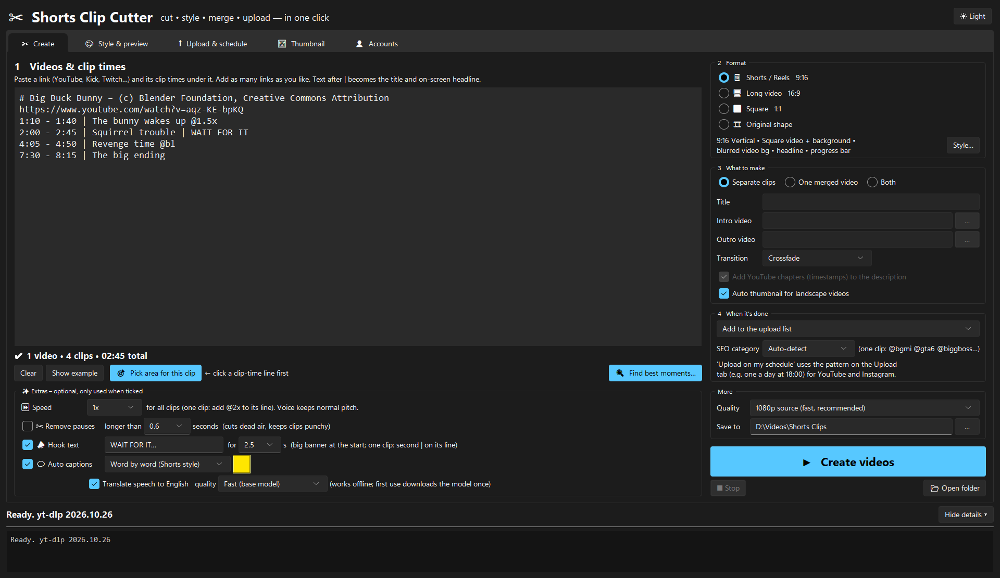
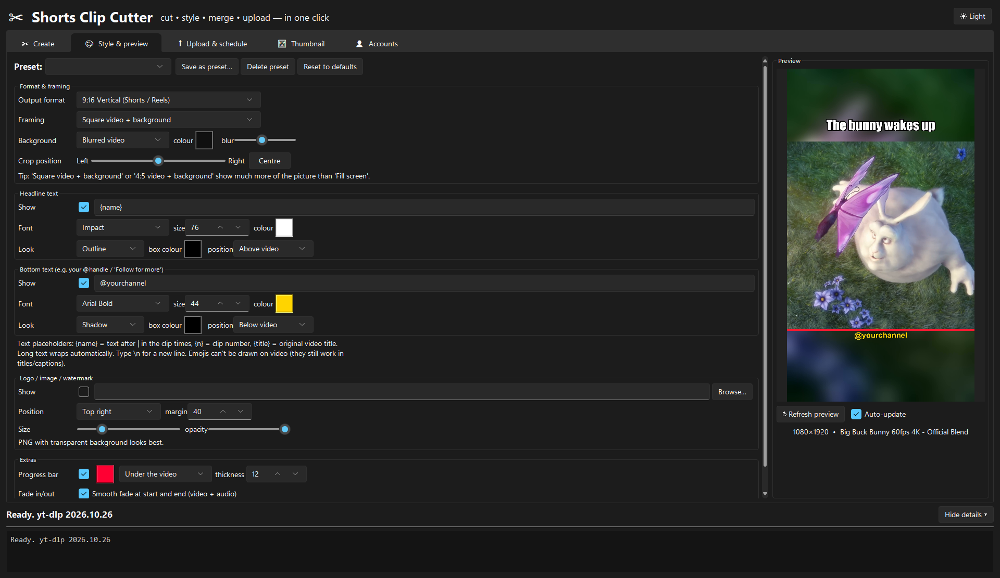
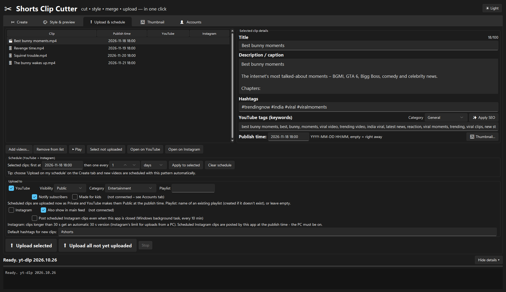
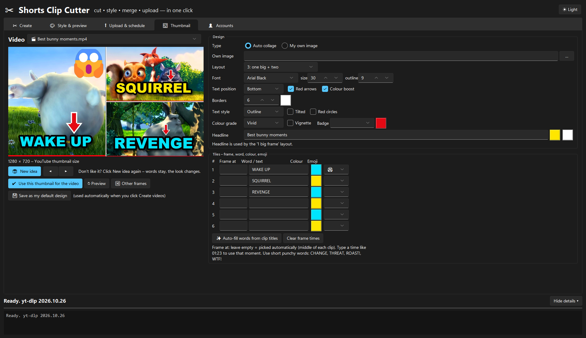

<h1 align="center">Shorts Clip Cutter</h1>

<b>Turn long videos into ready-to-post Shorts, Reels and long videos – in one click.</b> 
A Windows app by <b>Nudge4</b> • Windows 10/11 (64-bit)

  <a href="https://rishav33.gumroad.com/l/shorts-clip-cutter"><b>🛒 Buy on Gumroad – $9.99</b></a> &nbsp;•&nbsp;
  🪟 Microsoft Store – coming soon &nbsp;•&nbsp;
  <a href="PRIVACY.md">🔒 Privacy</a> &nbsp;•&nbsp;
  <a href="../../issues/new">💬 Support</a>

---

## Screenshots

| Create | Style & preview |
|---|---|
|  |  |
| **Upload & schedule** | **Thumbnail Studio** |
|  |  |

---

## What it does

### ✂ Cut clips – from many videos at once
- Paste a link (YouTube, Kick, Twitch and more) and the times you want: `02:10 - 03:05 | Wait for it`
- Add as many links and clips as you like – only the parts you choose are processed, no full downloads
- **🔍 Find best moments** – picks the top clips of a long video from viewer **comment timestamps** and
  YouTube's **"most replayed"** graph, and names them from the top comment
- **🎯 Pick area** – keep only part of the picture (e.g. a streamer's facecam) or use **split screen**

### 🎨 Make it look great
- **Shorts / Reels 9:16**, **long video 16:9**, **square** or original shape
- Square / 4:5 / full video on a **blurred or colour background** – no more over-zoomed crops
- Headline and bottom text, your **logo**, **progress bar**, fades and level volume – with **live preview**
- **Merge clips** into one video with transitions, intro/outro and automatic **YouTube chapters**

### ✨ Extras (one tick each)
- **Auto captions** – word-by-word Shorts style, with translation to English, works offline
- **Speed-up** 1.25×–4× (normal-pitch voice) • **pause remover** • **hook banner** for the first seconds

### 🖼 Thumbnails that get clicks
- Collage layouts, bold words, arrows, emojis, colour grading
- **🎲 New idea** – a fresh eye-catching design on every click – or use your own image

### ⬆ Publish without the busywork
- Upload or **schedule** to your own **YouTube** channel and **Instagram** (with your own free developer keys)
- **Automatic SEO** – category, description, hashtags, keyword tags and captions for every clip
- Or just let it run: **one click** cuts, styles, captions, merges, makes thumbnails and schedules everything

---

## Get it
- **Gumroad:** https://rishav33.gumroad.com/l/shorts-clip-cutter – zip download + your license key
- **Microsoft Store:** coming soon

Everything is included – no Python, ffmpeg or other installs needed.

## Use it responsibly
Only cut and publish videos you own, have permission to use, are licensed for reuse
(e.g. Creative Commons) or where your use is allowed by law. You are responsible for following the terms
of the sites you use.

## Privacy & support
- The app collects no data – see the [Privacy Policy](PRIVACY.md).
- Questions or problems? [Open an issue](../../issues/new) (please don't post license keys or logins).

---
This repository hosts the product page, privacy policy and support for Shorts Clip Cutter.
YouTube, Instagram and Kick are trademarks of their owners; Shorts Clip Cutter is not affiliated with them.
